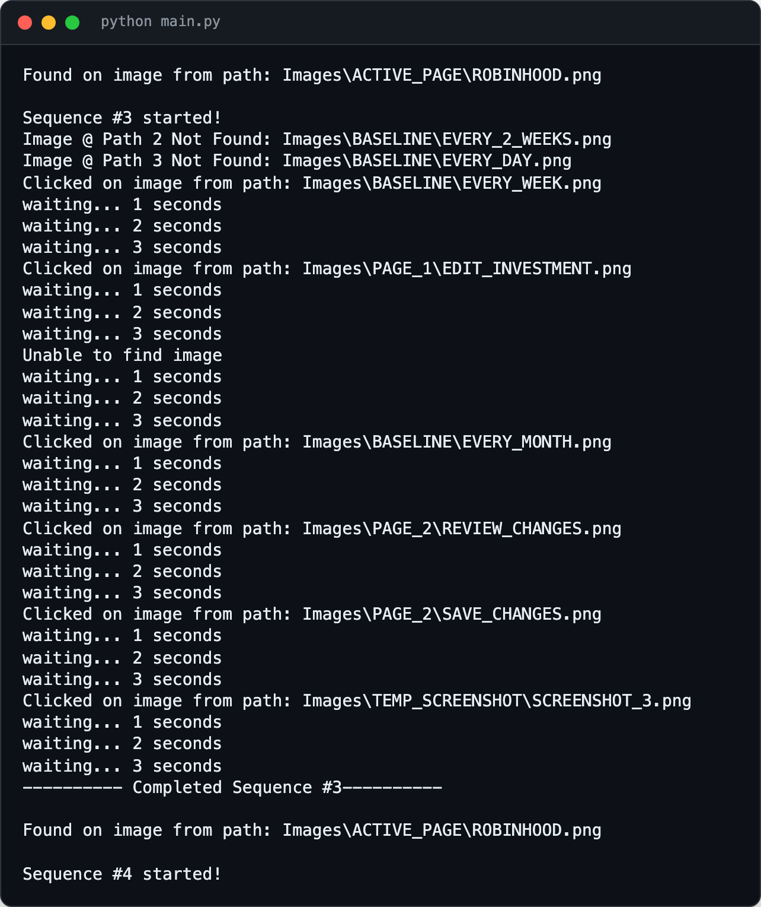
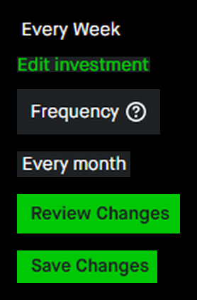

<div align="center">

<h1>robinhood-change-recurring</h1>

<p><b>Bulk-changes Robinhood recurring buy frequencies.</b></p>

<p><i>Robinhood has no bulk edit: switching dozens of weekly recurring buys to monthly is dozens of trips through the same four screens.</i></p>

<h6>


-555555?style=flat-square)

</h6>

<a href="#how-it-works"><b>How it works</b></a> ·
<a href="#run-it"><b>Run it</b></a> ·
<a href="#limits"><b>Limits</b></a>

<br><br>



<sub>Sample output in the script's print format. No account, login or holdings involved.</sub>

</div>

<br>

## Why

Changing how often a recurring investment buys means opening it, editing, picking a new
frequency, reviewing and saving, one investment at a time. This script drives the Robinhood
website in a browser by looking at the screen and clicking, so a whole list of recurring buys
can be moved from weekly, every two weeks or daily to monthly in one run. It uses no
Robinhood API and never sees credentials; you log in yourself. Written in 2022, last touched
in May 2023.

## How it works

<div align="center">

<br><sub>Some of the template images in <code>Images/</code>, cropped from Robinhood's dark theme.</sub>
</div>

1. **Check the page.** It only runs while the Robinhood feather logo is on screen.
2. **Find a buy to change.** On the recurring investments list it looks for "Every Week",
   "Every Two Weeks" or "Every Market Day", scrolling down until the "Create recurring
   investment" button shows it has reached the bottom. It saves a small screenshot of that row.
3. **Edit it.** Edit investment, Frequency, Every month, Review Changes, Save Changes, with
   3-second waits.
4. **Go back.** It clicks the saved row screenshot (confidence 0.95) to return, then repeats,
   up to 99 times. On an error it moves the row screenshots to `Images/OLD_SCREENSHOTS`.

All matching is `pyautogui.locateCenterOnScreen`, grayscale, confidence 0.8.

## Run it

Windows, with a browser logged in to Robinhood on the recurring investments list, in dark mode
and at the zoom level the crops were taken at.

```bash
python -m venv venv
venv\Scripts\activate
pip install -r requirements.txt     # pyautogui, opencv-python, pillow
python main.py
```

To change other frequencies, edit the `baselineCheckImg*` (from) and `changeFrequencyImg` (to)
paths at the top of `main.py`. Move the mouse into a screen corner to stop (PyAutoGUI fail-safe).

## Limits

- **Tied to the 2022 Robinhood web UI.** A redesign, light mode or a different zoom breaks the
  matches; the crops would need retaking.
- **Windows paths.** Image paths use backslashes.
- **Check the result.** It edits real recurring investments; review them in the app afterwards.
- `tessaract-test.py` is an unfinished OCR experiment with Tesseract and isn't used.

<br>

<div align="center">
<sub>Built with PyAutoGUI and OpenCV. Not affiliated with Robinhood.</sub>
</div>
